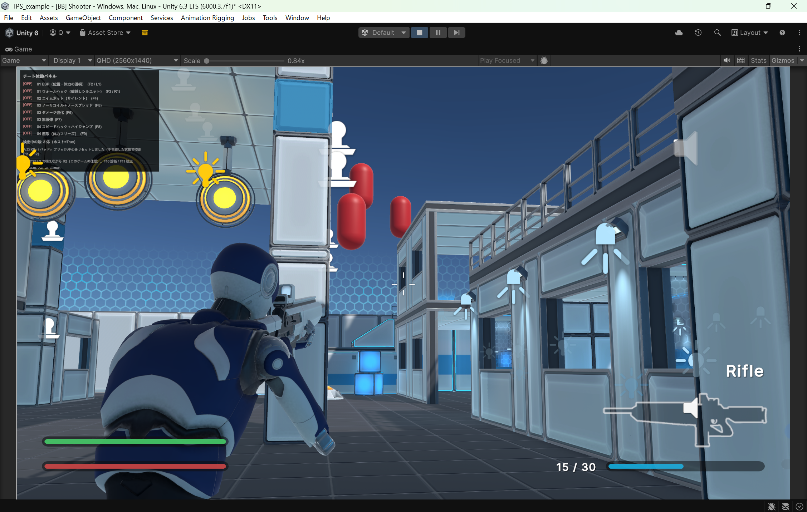
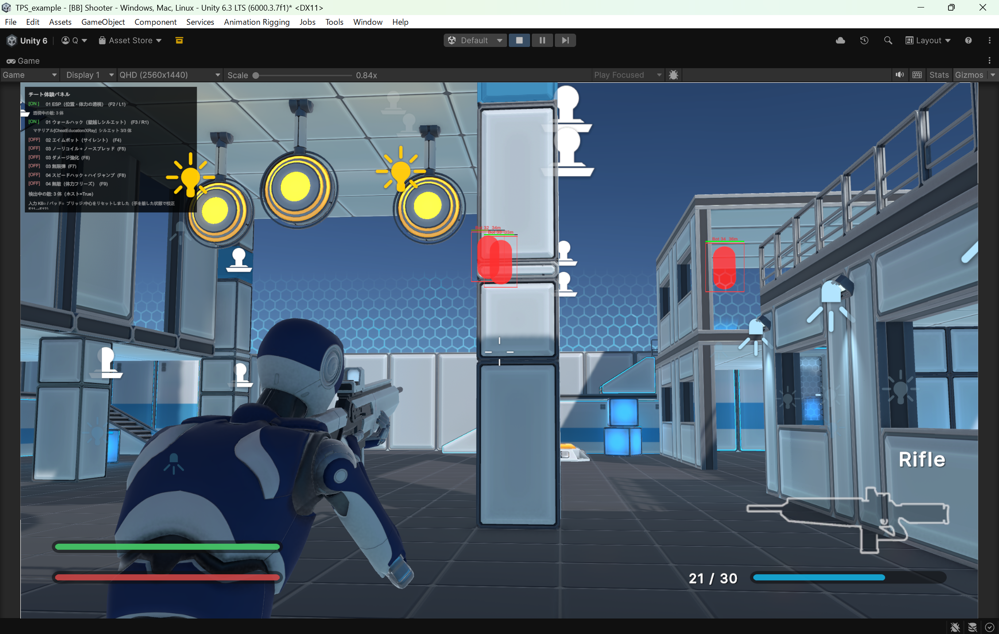
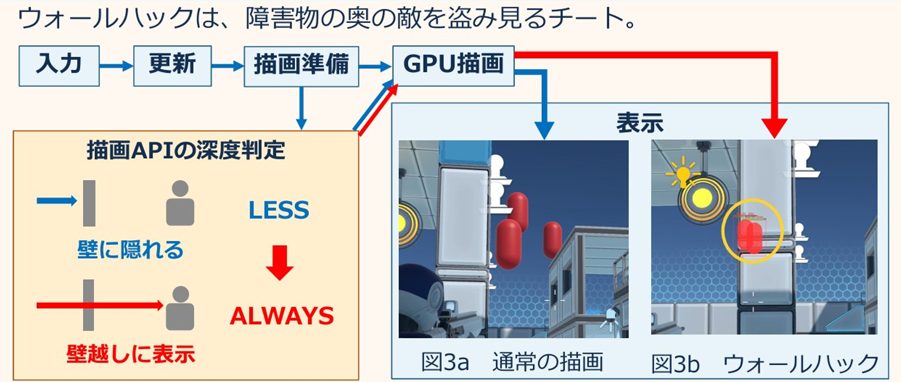

# Unity チート体験・対策教材

ゲーム内のチートが**どのように見え、なぜ成立するのか**を、自分の PC 上のシューティング環境で学ぶ教材です。ESP や壁越し表示などを体験し、ゲーム開発者がどのように対策を考えるかを学びます。

本教材は、SecHack365 で制作中の自作ゲームエンジン [Noctis — Secure Game Engine](https://github.com/Qutalize/Noctis---Secure_Game_Engine) に関連する研究作品です。Noctis で取り組むゲームエンジンとチート対策の研究を、Unity 上で体験するために制作しています。

> **個人のローカル環境での学習専用です。** 公開サーバー、オンライン対戦、他人のゲームや第三者が管理する環境での使用は禁止します。

## 教材内容

Unity 公式の三人称シューティング（TPS）テンプレートに教材を追加し、練習用ボットを相手にチートの見え方を切り替えます。


*通常画面の例。TPS の視点から練習用ボットを観察します。*


*ESP とウォールハックを有効にした画面の例。位置や赤いシルエットが表示されます。画面はイメージです。使用する Editor は事前準備のバージョンを選んでください。*

### 壁越しに見える仕組み

通常の描画では、壁の奥にいる対象は壁に隠れます。教材のウォールハックでは、対象のシルエットを描くときに深度判定を `Always` にすることで、壁の手前に重ねて表示します。画面に表示できるのは、クライアントが既に持っている情報です。



## 提供体験

| 操作 | 内容 |
|---|---|
| **F1** | チート体験パネルの表示・非表示 |
| **F2** | ESP：対象の位置・距離・体力を表示 |
| **F3** | ウォールハック：対象を赤いシルエットで表示 |
| **F4** | エイムボット |
| **F5** | ノーリコイル |
| **F6 / F7** | ダメージ強化 / 無限弾 |
| **F8 / F9** | スピード変更 / 無敵 |

各機能の原理や対策の考え方は、[レッスン一覧](LESSONS/)と[チートと対策の早見表](DEFENSE_AND_THEORY.md)を参照してください。レッスン内の導入手順には旧環境の記述があるため、準備と起動はこの README に従ってください。

## 事前準備

このリポジトリは **Unity プロジェクトそのものではありません**。Unity 公式テンプレートを各自で入手し、そこに教材を追加します。

- **Unity Hub** と、有効な Unity アカウント・ライセンス
- **Unity Editor 6000.3.27f2**
- Unity Hub の **Multiplayer Third Person Gameplay 1.0.8** テンプレート
- **Python 3.10 以降**（Windows では `py` または `python` コマンドを使用）
- テンプレートとパッケージを取得するためのインターネット接続、および十分なディスク空き容量

Unity Hub と Editor は [Unity の公式ダウンロードページ](https://unity.com/download)から入手してください。Unity のセキュリティ更新については、[Brotli の勧告](https://unity.com/security/unity-brotli-decoder-vulnerability)と[証明書に関する勧告](https://unity.com/security/unity-emudhra-compromise)を参照してください。

> Windows では、パスが長すぎると素材の読み込みに失敗することがあります。プロジェクトは `D:\UnityProjects\CheatStudy` のような短い場所に作成してください。

## 導入方法

### 1. Unity プロジェクトを作る

1. Unity Hub で **Unity Editor 6000.3.27f2** をインストールします。
2. 「新しいプロジェクト」を選び、同じ Editor バージョンで **Multiplayer Third Person Gameplay 1.0.8** を選択します。
3. 新しいフォルダーにプロジェクトを作成し、初回インポートが終わったら **Unity Editor を終了**します。
4. この教材を Git で取得するか、GitHub の **Code → Download ZIP** からダウンロードして展開します。

### 2. 教材を追加する

Windows の PowerShell を開き、次のコマンドでこの README がある教材フォルダーに移動してから、導入コマンドを実行します。フォルダーのパスはエクスプローラーのアドレス欄から確認できます。

```powershell
cd '展開した教材フォルダーのパス'
```

`D:\UnityProjects\CheatStudy` は、手順 1 で作った **Unity プロジェクトの場所**に置き換えてください。

```powershell
py .\tools\install.py 'D:\UnityProjects\CheatStudy'
```

`py` が使えない場合は `python` に置き換えてください。macOS / Linux では `python3 tools/install.py '/作成した/プロジェクト'` を使用します。

インストーラーは教材を追加し、必要なパッケージとテンプレートの初期化処理を設定します。変更前のファイルは、Unity プロジェクト内の `.cheat-education-backup/` に保存されます。既に教材やバックアップがある場合は上書きせず停止するため、やり直すときは新しいテンプレートを作成してください。

**Netcode for GameObjects 2.14.0 は Unity 6.3 ではプレリリースです。** この教材は学習用です。製品に組み込む場合は、使用する環境で互換性を確認してください。

### 3. 起動する

1. Unity Hub から、教材を追加したプロジェクトを開きます。パッケージ解決とコンパイルを待ちます。
2. Project ウィンドウで `Assets/Shooter/TestScenes/[BB] Shooter.unity` を開きます。`MultiplayerSession` が付かない方を選びます。
3. メニュー **Tools → Cheat Education → レッスン01 をセットアップ** を選び、シーンを保存します。練習用ボットと体験パネルが追加されます。
4. **Play → Start Host** の順に選びます。Game 画面をクリックし、F1〜F9 で表示や機能を切り替えます。
5. 終わったら Play を停止します。通信の実験は **localhost / Multiplayer Play Mode** に限定してください。

## 対策に実装

`ServerVisibilityFilter` は、クライアントに表示する対象をサーバー側で切り替える仕組みを学ぶための**試作**です。使用するには対象へコンポーネントを追加し、壁のレイヤーを設定する必要があります。接続時や通信中を含む完全な防御を保証するものではありません。命中・移動の対策にも、接続作業が必要な雛形が含まれます。キー操作が効かない場合は Game 画面にフォーカスを合わせ、必要に応じて Fn キーも確認してください。

## 利用条件・禁止事項

- 本教材は、各自の PC 上での学習を目的として提供します。GitHub からのダウンロード・クローンと、ローカル環境での導入・学習は可能です。
- 本リポジトリの**教材独自のコード、文章、図、画像の二次配布・転載・再公開を禁止**します。
- チートを公開サーバー、オンライン対戦、他人のゲーム、第三者が管理する環境で使用するなどの**悪用を禁止**します。
- Unity テンプレートやフォント、Unity Editor、PackageCache 本体は含まれていません。利用者が各自で入手し、Unity および各権利者の利用条件に従ってください。画像には Unity 公式テンプレートを使った画面が含まれます。第三者に権利がある部分には、それぞれの条件が適用されます。
